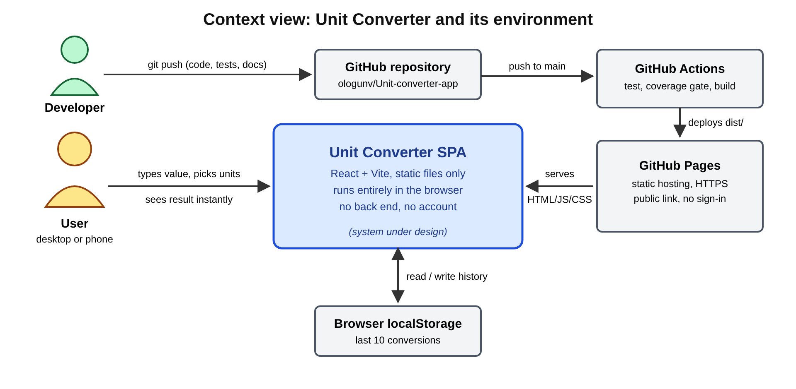
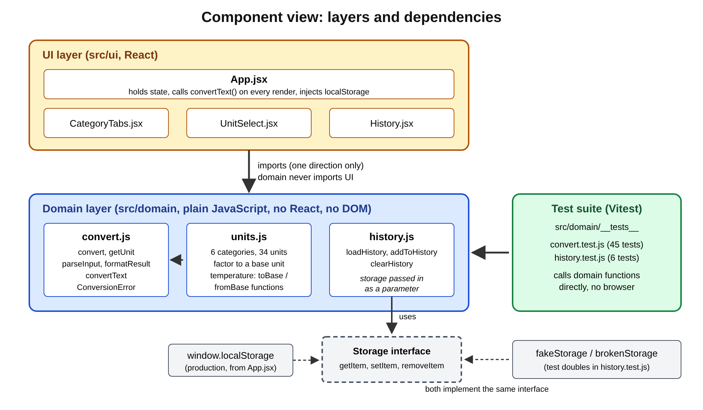
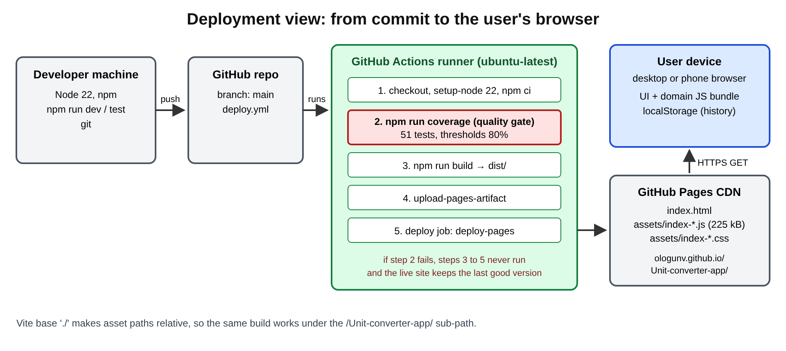

# Unit Converter with Test Suite: Architecture Report

**Course:** CMPS 570 Software Architecture, Bay Atlantic University\
**Instructor:** Dr. Tsige Tessema\
**Student:** Victor Ologun\
**Project:** Catalogue project 10, Unit Converter with Test Suite\
**Main quality attribute:** Testability\
**Live app:** https://ologunv.github.io/Unit-converter-app/\
**Repository:** https://github.com/ologunv/Unit-converter-app\
**Date:** November 2026

## 1. Introduction and purpose

This report describes the architecture of a small single-page web application that converts values between units. The user picks a category (length, weight, temperature, volume, time or speed), types a number, and the result appears while typing. Recent conversions can be saved to a history list that stays in the browser.

The functional side of the app is simple on purpose. The real goal of the project is to show that the architecture makes the software easy to test, and to prove it with measurements. Bass, Clements and Kazman define testability as "the ease with which software can be made to demonstrate its faults through (typically execution-based) testing". In my opinion a unit converter is a good fit for this attribute: a wrong factor is a silent bug that a user may never notice, so the only real protection is a test suite that is cheap to run and hard to skip.

The report covers the requirements that shaped the architecture, three testability scenarios, the context, component and deployment views, the tactics used, a summary of the ADRs and an evaluation of testability based on measured evidence.

## 2. Architecturally significant requirements and constraints

| ID | Requirement or constraint | Source | Effect on the architecture |
|---|---|---|---|
| R1 | At least 5 unit categories | Project charter | Generic conversion through a base unit per category (ADR 0002) |
| R2 | Instant conversion while typing | Project charter | Conversion must be a fast, synchronous function call |
| R3 | Conversion logic in a separate module | Project charter | Domain layer with no UI imports (ADR 0001) |
| R4 | Automated tests, 80%+ coverage | Project charter | Vitest with an 80% threshold on four coverage measures (ADR 0003) |
| R5 | Conversion history (stretch) | Project charter | `history.js` with storage passed in as a parameter |
| C1 | No back end, data stays in the browser | Course constraint | Static files only, `localStorage` for history |
| C2 | Free public hosting with no sign-in | Course constraint | GitHub Pages, deployed by GitHub Actions |
| C3 | Works on desktop and phone | Course constraint | Responsive CSS, numeric keyboard on phones (`inputMode="decimal"`) |
| C4 | One developer, about two weeks | Practical | Few dependencies, no state library, no router |

R3 and R4 are the requirements that matter most for the main quality attribute. R2 also matters indirectly: because conversion has to be instant, it had to be a plain function with no network call or delay, and a plain function is exactly what is easiest to test.

## 3. Quality-attribute scenarios

All three scenarios use the six-part form from Bass, Clements and Kazman. The response measures were set before the measurements in section 7 were taken.

**Scenario 1: A wrong conversion factor is caught before it goes live**

| Part | Value |
|---|---|
| Source | Developer |
| Stimulus | Commits a change that makes a conversion factor wrong (mile changed from 1609.344 m to 1600 m) |
| Environment | Continuous integration, after a push or a manual run of the GitHub Actions workflow |
| Artifact | `units.js` and the Test and deploy pipeline |
| Response | The test suite runs automatically, the failing test names the broken conversion, the build and deploy steps are skipped and the live site keeps the last good version |
| Response measure | Fault reported in under 2 minutes from the start of the pipeline; 0 faulty builds reach GitHub Pages |

**Scenario 2: A new unit is covered by existing tests**

| Part | Value |
|---|---|
| Source | Developer |
| Stimulus | Adds a new unit (nautical mile) to an existing category |
| Environment | Development time, on the developer's machine |
| Artifact | `units.js` (unit data) |
| Response | Only the data file changes; the existing round-trip test converts the new unit to and from every other unit in its category |
| Response measure | 1 line changed, 0 test files changed, all tests pass and domain coverage stays at or above 80% |

**Scenario 3: Invalid input is tested without the user interface**

| Part | Value |
|---|---|
| Source | Tester |
| Stimulus | Wants to check how the app treats text that is not a valid number (empty text, letters, "1.2.3", "Infinity", overflow) |
| Environment | Development time, Node.js with no browser |
| Artifact | `parseInput()` in `convert.js` |
| Response | The tester calls `parseInput()` directly with each input; invalid input returns `null` and valid input returns a number |
| Response measure | 100% of invalid cases return `null`; the input tests run in under 1 second with no DOM, no mocks and no browser |

## 4. Architecture views

### 4.1 Context view



The system is a set of static files that run entirely in the user's browser. There are two kinds of people outside the system. The user types values and reads results on a desktop or a phone. The developer pushes code to the GitHub repository, which starts GitHub Actions. Actions tests and builds the app and hands the files to GitHub Pages, which serves them over HTTPS. The only data the app keeps is the history list, which lives in the browser's `localStorage`. There is no server, no account and no external API, so nothing outside the browser has to be faked when the logic is tested.

### 4.2 Component view



The code has two layers, and they match the folders in the repository.

- **UI layer (`src/ui`)**: React components. `App.jsx` holds the state (category, units, input text, history), calls `convertText()` on every render, and passes `window.localStorage` to the history functions. `CategoryTabs`, `UnitSelect` and `History` only display data and report clicks.
- **Domain layer (`src/domain`)**: plain JavaScript with no React, DOM or browser imports. `units.js` holds the data for 34 units in 6 categories. `convert.js` holds `convert`, `getUnit`, `parseInput`, `formatResult`, `convertText` and the `ConversionError` class. `history.js` loads, adds and clears history through a storage object that it receives as a parameter.

The dependency goes one way: the UI imports the domain, and the domain never imports the UI. The test suite sits beside the UI as a second client of the domain layer. `history.js` only needs an object with `getItem`, `setItem` and `removeItem`, so in production it gets the real `localStorage` and in tests it gets `fakeStorage` or `brokenStorage`.

### 4.3 Deployment view



The developer works locally with Node 22 and pushes to `main`. A push starts the `deploy.yml` workflow on an Ubuntu runner. The build job installs dependencies with `npm ci`, then runs `npm run coverage`, which is the quality gate: if a test fails or any coverage measure drops below 80%, the job stops there. Only after the gate passes does it build `dist/` and upload it. A second job deploys the files to GitHub Pages. The browser downloads one HTML file, one JavaScript bundle (about 225 kB, 71 kB gzipped) and one CSS file. Vite's `base: './'` makes the asset paths relative, so the same build works under the `/Unit-converter-app/` sub-path.

The three views are consistent with each other: the domain and UI layers in the component view are the JavaScript bundle in the deployment view, and the coverage gate in the deployment view is the test suite in the component view running on a CI runner.

## 5. Tactics for testability

Bass, Clements and Kazman group testability tactics into two sets: control and observe system state, and limit complexity. The tactics used in this project are listed below with the code that implements each one.

| Tactic (category) | Where it is used | What it gives the tests |
|---|---|---|
| Limit structural complexity (limit complexity) | Two layers with one-way dependencies; domain has no UI or browser imports | Tests import three small modules, never the UI |
| Limit nondeterminism (limit complexity) | `convert`, `parseInput` and `formatResult` are pure functions: same input, same output, no clock, no randomness, no network | Tests are repeatable and need no setup or cleanup |
| Abstract data sources (control and observe state) | `history.js` receives its storage as a parameter | A fake storage replaces `localStorage`; a broken storage simulates a full or blocked browser |
| Localize state storage (control and observe state) | UI state lives only in `App.jsx`; saved data lives under one key in `history.js` | Tests can set and read the whole state through one small interface |
| Specialized interfaces (control and observe state) | `convertText()` returns `{ output, error }`, and `ConversionError` carries a `code` such as `UNKNOWN_UNIT` | Tests check exactly what the UI will show and why a call failed, without rendering anything |
| Data-driven design (supports limit structural complexity) | Every linear unit is one line with a factor to a base unit (ADR 0002) | One generic round-trip test covers all 210 unit pairs |

The last row is not one of the textbook tactic names, but I list it because it had the largest effect. Without the base-unit table, every pair of units would need its own function and its own test.

The pipeline adds one more measure that is not a tactic inside the code but supports testability in practice: tests run automatically on every push to `main`, and failing tests block the deployment (ADR 0003). In my opinion a test suite that runs only when someone remembers to run it is not much protection, so this gate is as important as the code structure.

## 6. Architecture decisions

The full records are in `docs/adr` in the repository. Each one lists the context, the options considered, the decision and the consequences.

| ADR | Decision | Options rejected | Link to testability |
|---|---|---|---|
| 0001 | Keep conversion logic in a separate domain module with no React or browser imports | Logic inside components; logic in custom hooks | Tests call functions directly, with no DOM and no rendering |
| 0002 | Convert through a base unit using a data table; temperature uses `toBase` and `fromBase` functions | One function per unit pair; a third-party library | One round-trip test covers every pair; adding a unit needs no new test |
| 0003 | Vitest with an 80% coverage threshold that blocks deployment | Jest; running tests by hand | Every change is tested before it can go live, and coverage is measured on every run |

The main trade-off across all three decisions is that the UI layer has no automated tests. I accepted this because the UI is thin: it reads input, calls one domain function and displays the result. Section 7 comes back to this limit.

## 7. Evaluation of testability

### 7.1 Test suite and coverage

The suite has 51 tests in two files: 45 in `convert.test.js` and 6 in `history.test.js`. Running `npm run coverage` gives:

```
 Test Files  2 passed (2)
      Tests  51 passed (51)
Statements   : 100% ( 63/63 )
Branches     : 100% ( 41/41 )
Functions    : 100% ( 17/17 )
Lines        : 100% ( 51/51 )
```

Over five runs on the development machine, Vitest reported a test duration of 98 to 115 ms, and the full command, including starting Node, took 432 to 475 ms. In GitHub Actions the whole successful run, from the push to the site being live, took 27 seconds ([run 1](https://github.com/ologunv/Unit-converter-app/actions/runs/45910806194)).

### 7.2 Scenario results

| Scenario | Response measure | Measured result | Met? |
|---|---|---|---|
| 1. Wrong factor caught | Fault reported in under 2 min; 0 faulty builds deployed | Pipeline failed 14 s after it started. `npm run coverage` failed with "expected 1.6 to be close to 1.609344"; build, upload and deploy were all skipped ([run 2](https://github.com/ologunv/Unit-converter-app/actions/runs/45911447397)) | Yes |
| 2. New unit covered | 1 line changed, 0 test files changed, tests pass, coverage ≥ 80% | Adding `nmi: { label: 'Nautical mile', factor: 1852 }` changed 1 line in `units.js`; 51 of 51 tests passed and coverage stayed at 100%. With a broken factor of 0, the round-trip test failed | Yes |
| 3. Invalid input without UI | 100% of invalid cases return `null`; under 1 s | All 11 invalid inputs returned `null`, and all 18 `parseInput` tests ran in 98 ms in Node with no DOM | Yes |

For scenario 1 I made the change on a separate branch and ran the workflow there by hand, so the real `main` branch and the live site were never at risk. The change was then reverted.

### 7.3 Honest limits

The numbers look very good, but they need context.

1. **100% coverage does not mean 100% correct.** Coverage only says each line ran during a test. To guard against this, every category has at least one test against a known real value (for example 212 °F = 100 °C and 1 US gallon = 3.785411784 L).
2. **The round-trip test has a blind spot.** It proves that converting from A to B and back gives the original value, so it catches a factor of 0 or a missing factor. It does not catch a factor that is wrong but still consistent: with the mile set to 1600 m, the round trip still worked, and only the explicit mile-to-kilometre test failed. In scenario 2 this means a new unit is checked for being usable, not for having the right value. A reference-value test per unit would close this gap, and I think it is the most useful next step.
3. **The UI layer is not tested automatically.** Coverage is measured on `src/domain` only. A bug in `App.jsx`, for example in how the swap button changes the units, would not be caught by the pipeline. The UI was checked by hand in a browser at phone and desktop widths. Adding React Testing Library or a Playwright end-to-end test would raise confidence here, at the cost of slower tests.
4. **Floating-point results are approximate.** Tests use `toBeCloseTo`, and the UI rounds to 6 significant digits. This is the correct behaviour for a unit converter, but it means a tiny error in the last digits would not be reported.

Even with these limits, the evidence supports the claim that the architecture is testable: the logic that matters is fully covered, the tests are fast enough to run on every push, and a deliberate fault was stopped before it reached users.

## 8. Conclusion

The project meets its functional must-haves (six categories, instant conversion, a separate conversion module, high test coverage) and the stretch goal of conversion history. More importantly for this course, the main design choices came from the testability goal: a pure domain layer with one-way dependencies, a base-unit data table, storage passed in as a parameter, and a pipeline that will not deploy untested code. All three scenarios met their response measures. The weak points are the missing UI tests and the round-trip test's blind spot for consistently wrong factors. In my opinion, the most valuable lesson from this project is that testability is decided early: because the conversion logic never depended on React, testing it was cheap from the first day, and that is what made the 100% coverage possible.

## References

Bass, L., Clements, P. and Kazman, R. (2021). *Software Architecture in Practice*, 4th ed. Addison-Wesley. Chapter 12, Testability.

Nygard, M. (2011). *Documenting Architecture Decisions*. https://cognitect.com/blog/2011/11/15/documenting-architecture-decisions
